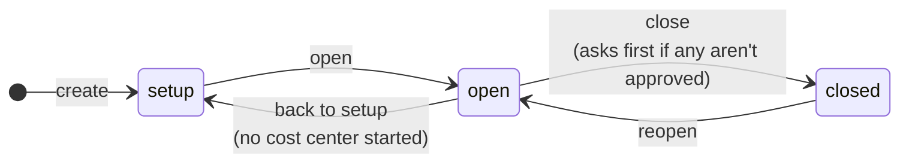
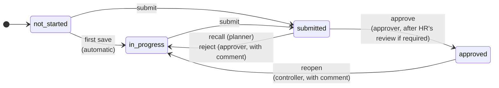

# Statuses

A planning round has a status, and so does each cost center in it. Investments, position
transfers and pay have their own states on top. This page shows them all, with who moves them
and what each one allows. The decisions behind them are in [ADR 0008](adr/0008-workflow.md),
[ADR 0024](adr/0024-order-of-a-personnel-costs-round.md), [ADR 0028](adr/0028-capex-planning.md),
[ADR 0021](adr/0021-position-transfers-and-home.md) and
[ADR 0035](adr/0035-workflow-recall-returned.md).

## The round

| Status | Who changes values | |
|---|---|---|
| **setup** | controllers | The controller prepares the round: entry forms, comparisons, cost centers, carried values. Planners can't enter anything yet. |
| **open** | planners, as their cost center's status allows | Planning runs. |
| **closed** | nobody | Plan values, hours, FTE, investments and pay are fixed; notes stay writable. Reopen to change anything. |

All round status changes are the controller's, on the *Status* page. Closing is refused while a
cost center has personnel costs of fewer people than the round's minimum (small groups, until HR
charges them elsewhere). Closing with cost centers not approved asks for confirmation and lists
them.

## A cost center in an open round

| Action | Who | Needs |
|---|---|---|
| submit | the owner, a deputy or a controller | |
| recall | the owner or a deputy | not yet approved |
| approve | the nearest approver above the cost center, or a controller | not someone who plans it; HR's confirmation of the pay when the round requires it |
| reject | as approve | a comment |
| reopen | a controller | a comment |

- **Not started** and **in progress** are editable; **submitted** and **approved** are read only
  for everyone, the database's lock trigger included.
- A **reject** or a **reopen** shows on the planner's sheet and *Home*, with who, when and the
  comment, until they submit again. A recall says nothing to anyone.
- Every change of status is a workflow event with the actor, the time and the comment.
- Values written by the app follow their sources whatever the status: forwarding charges and
  credits, capacity credits, personnel totals.

## Alongside

These have states of their own and don't move the cost center's status.

| What | States | Who moves them |
|---|---|---|
| **Investment** or large project | open → confirmed or declined (declining needs a reason); back to open when what was confirmed changes (amount, start, type, cost center, project) | confirmers: controllers and approvers above the cost center, not one who plans it |
| **Position transfer** | proposed → accepted or declined | proposed by the sending cost center, decided by the receiving one or a controller |
| **Pay in a round with personnel costs** | round opened → access released by HR → pay handed over per cost center; HR's review before approval if the round requires it | the controller opens, HR releases, hands over and reviews |

In a closed round, investments and pay can't change.
